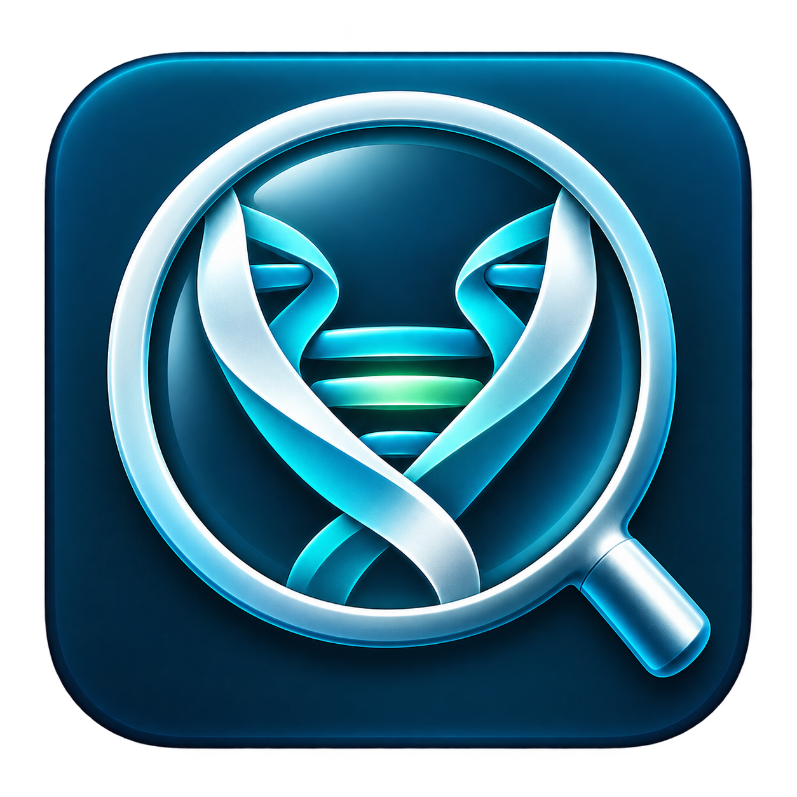
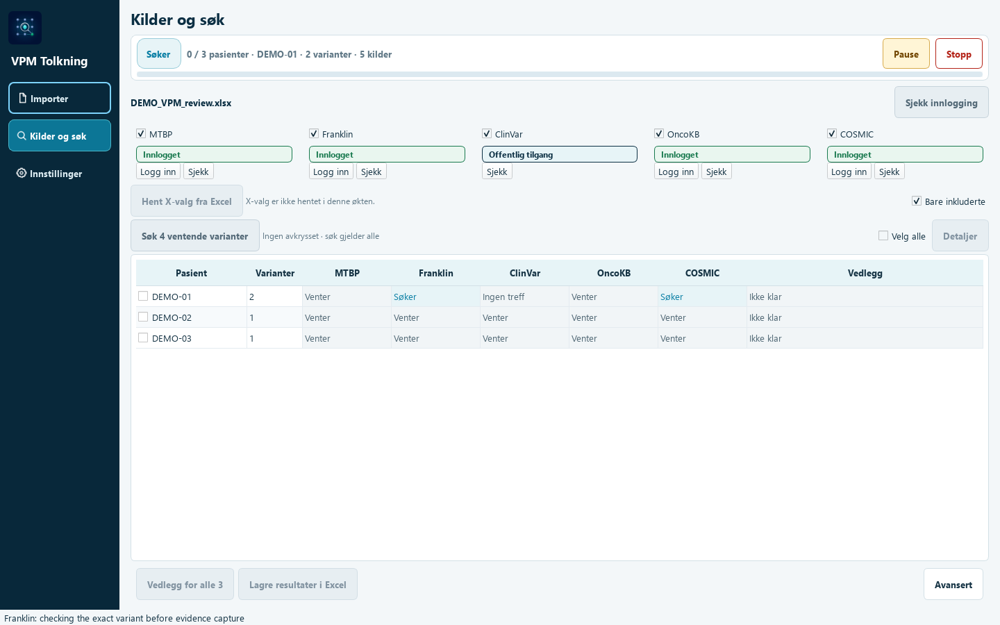

<p align="center">
  
</p>

# VPM Tolkning

VPM Tolkning er en Windows-app for gjennomgang av somatiske varianter fra
Archer Analysis. Appen samler variantutvalg, databasesøk, dokumentasjon og
Excel-vedlegg i én arbeidsflyt. Archer-eksporter fra v6 og v7 støttes.



Appen er et tolkningsverktøy. Funn, variantidentitet, referanselister og rapporter
må kontrolleres av kvalifisert personell før klinisk bruk.

- [Illustrert brukerguide med PDF og nettleserversjon](docs/brukerguide/README.md)
- [Redigerbare artefakt- og WHO-lister](reference_lists/README.md)
- [Lagring, innlogging og feilsøking](docs/drift.md)

## Krav og installasjon

Du trenger Windows, Python 3.11 eller nyere, Microsoft Edge og tilgang til
databasene du vil bruke. Excel brukes til manuell gjennomgang av arbeidsbøkene.
Innlogging og tilgang hos den enkelte dataleverandøren må ordnes separat.

Pakken installeres i et eget Python-miljø. Fra mappen der du har lastet ned
wheel-filen for versjonen du skal bruke:

```powershell
py -3.11 -m venv .venv
.\.venv\Scripts\python.exe -m pip install .\archer_prosess-0.1.0-py3-none-any.whl
.\.venv\Scripts\vpm-tolkning.exe
```

Installasjonen henter også Python-avhengighetene og trenger derfor nettverk
eller et lokalt pakkelager. Dette er en Python-distribusjon; en separat
Windows-installer følger ikke med. Ved installasjon fra kildekode, se
[utviklingsveiledningen](CONTRIBUTING.md).

## Arbeidsflyt

1. Importer en Archer-TSV og opprett Excel-arbeidsboken for gjennomgang.
2. Gå gjennom **With Artifacts** i Excel. Sett `X` i **Skip Database Search (X)**
   for varianter som ikke skal søkes opp, og lagre filen.
3. Last den gjennomgåtte arbeidsboken inn igjen i appen.
4. Velg kilder under **Kilder og søk**, og kontroller innloggingen.
5. Start søket. Med avkryssede pasienter behandles disse først; deres vedlegg
   genereres etter at evidensen er lagret i arbeidsboken. Uten avkryssing
   fortsetter søket med uferdige oppslag for alle pasienter.
6. Kontroller resultatene og bildene. **Vedlegg for …** lager vedlegg manuelt
   for avkryssede pasienter, eller for alle hvis ingen er avkrysset.

Avkryssing bestemmer arbeidsomfanget; markering av en rad bestemmer hvilken
pasient som vises i **Detaljer**. Vedlegg lagres i `VEDLEGG_APP` ved siden av
arbeidsboken som `<DIT>_VPM_Tolkning_APP.xlsx`.

**Pause** stanser ved neste trygge søkepunkt. **Fortsett** fortsetter køen.
**Stopp** beholder ferdige resultater og forsøker å lagre dem. En tidligere
analyse kan gjenåpnes fra den behandlede Excel-filen.

## Kilder og resultater

Appen søker i MTBP, Franklin, ClinVar, OncoKB og COSMIC. Nettlesersøk bruker
appens egne Edge-profiler. Manuell innlogging åpnes synlig; automatiserte
vinduer kan kjøre minimert.

Treffstatus og lagringsstatus vises hver for seg. Hvis Excel-filen er låst,
kan et mottatt resultat fortsatt vises i appen. Lukk filen og bruk
**Prøv ventende lagring igjen** for å fullføre lagringen. En feil eller et
uferdig søk skal ikke tolkes som «ingen treff».

Hvis en COSMIC-ID er flyttet, kan appen bruke GRCh38 som reserve for å finne
ny ID. Varianten må deretter bekreftes i GRCh37 før resultatet godtas.
ID-overgangen merkes **endret cosmic id** i Excel og evidensdataene.

Kildenes nettsider kan endres. Kontroller derfor at dokumentasjonen gjelder
rett variant og riktig genomreferanse, også når et oppslag er fullført.

## Innstillinger og data

Under **Innstillinger** velger du referanselister, utmappe, kontoer, Edge-profiler
og søketempo. En valgt referansefil erstatter den tilsvarende innebygde listen.
Se [formatkravene for referanselistene](reference_lists/README.md) før endring.

Pasientfiler, logger, skjermbilder og nettleserprofiler er lokale arbeidsdata og
skal oppbevares i egnede områder med tilgangskontroll. Ikke del arbeidsmappen
som en programdistribusjon. Se [driftsveiledningen](docs/drift.md) for hvor data
lagres og hva databasesøk sender ut.

## Bidrag og lisens

Feilrettinger og forbedringer er velkomne. Bruk syntetiske data i feilrapporter,
skjermbilder og tester. Se [CONTRIBUTING.md](CONTRIBUTING.md) for tester og bygging.

Prosjektet er lisensiert under **GNU GPL versjon 3**;
se [LICENSE](LICENSE). Når du distribuerer en endret versjon, må mottakerne få
tilgang til den tilhørende kildekoden under GPLv3. Lisensen tillater også salg
og krever ikke publisering av private endringer eller varsling til opphavspersonen.
Vi setter pris på at forbedringer foreslås tilbake til prosjektet.

Eksterne biblioteker og data har egne vilkår;
se [THIRD_PARTY_NOTICES.md](THIRD_PARTY_NOTICES.md).
